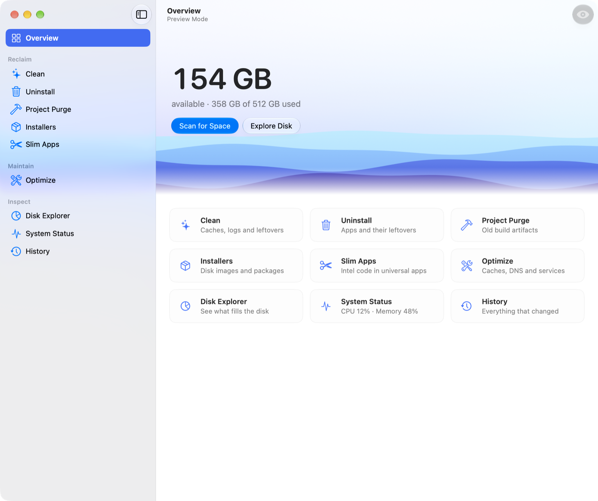

# Burrow

A native macOS app for cleaning up files, uninstalling apps, exploring disk usage, and monitoring system activity. Burrow runs your installed copy of the [Mole CLI](https://github.com/tw93/Mole) (`mo`) and shows its results in a SwiftUI interface.

**Website** · [burrow.mariusfanu.com](https://burrow.mariusfanu.com)



The Overview shows how much disk space you have and gives you a place to start a cleanup preview, explore what’s using space, or check system activity. The screenshot uses sample data.

Created by [Marius Fanu](https://mariusfanu.com).

Burrow is an independent, unofficial front end with its own name and icon. The Mole project does not endorse Burrow. The official Mole Mac app is available separately at [mole.fit](https://mole.fit).

## Requirements

- macOS 26 or newer
- Xcode 26 or newer with Swift 6.2 or newer, to build
- Mole CLI to run scans and actions. Burrow was last checked with [Mole 1.70.0](https://github.com/tw93/Mole/releases/tag/V1.70.0).

## Build and run from source

### Get the source and tools

```bash
git clone https://github.com/mariusfanu/burrow.git
cd burrow
```

If you're working on a fork, clone your fork's URL. Create a branch for your changes with `git switch -c my-burrow`.

Open Xcode once to finish its first-launch setup. Run `xcodebuild -version` and `swift --version` in Terminal to check that the active tools meet the requirements above. If they point to a different installation, choose the right one in **Xcode → Settings → Locations → Command Line Tools**.

If you use Homebrew and don't already have Mole, install it before trying the app's scans.

```bash
brew install mole
```

### Build a local app

From the repository root, build the release bundle and open it.

```bash
scripts/build-app.sh
open build/Burrow.app
```

The script packages the executable, icon and resources as `build/Burrow.app` for your Mac's architecture. It enables the hardened runtime and signs the app locally with an ad hoc signature, so you can build it without a paid Apple Developer account. Use `scripts/build-app.sh debug` for a debug bundle. To try a rebuild, quit the running copy before opening the new one. You can also copy the bundle to `/Applications`.

### Run in Xcode

1. Open `Package.swift` in Xcode.
2. Select the **Burrow** scheme and the native **My Mac** destination in the toolbar. If you see availability errors mentioning iOS, check whether the destination is a Mac Catalyst variant.
3. Choose **Product → Run** (⌘R) to launch Burrow under the debugger.

Xcode builds Burrow's Swift package executable. Use the packaging script above when you need a `Burrow.app` bundle.

### Try your build

If Burrow can't find `mo`, use **Choose CLI…** on the setup screen to select a trusted copy. If you just installed Mole, click **Check Again** to rescan for it.

Turn on **Preview Mode** in the toolbar, then open **Clean** and run a preview to see what Mole would remove. Some cleanup actions permanently delete files when run outside Preview Mode. If a scan or cleanup needs access to protected folders such as Trash, grant Burrow access under **System Settings → Privacy & Security → Full Disk Access**.

Run `swift test` from the repository root after making changes. The default suite runs without Mole. See [Tests](#tests) for release and host integration checks.

## Export a notarized app from Xcode

Generate the macOS app project from `project.yml`.

```bash
brew install xcodegen
xcodegen generate
open Burrow.xcodeproj
```

In the **BurrowApp** target's **Signing & Capabilities** tab, select your Apple Developer team. Choose the **Burrow App** scheme and a native Mac destination, then choose **Product → Archive**. In Organizer, select the archive and choose **Distribute App → Direct Distribution** to sign, notarize and export `Burrow.app`. [Apple’s Xcode distribution guide](https://developer.apple.com/documentation/xcode/distributing-your-app-for-beta-testing-and-releases.md)

## Build a signed release DMG

If this Mac needs a signing certificate, sign in to Xcode as the Apple Developer Account Holder. Open **Xcode → Settings → Accounts**, select your team, then choose **Manage Certificates → + → Developer ID Application**. Xcode installs the signing identity on this Mac. [Apple’s Xcode certificate instructions](https://developer.apple.com/documentation/xcode/sharing-your-teams-signing-certificates.md)

For the one-time notarization setup, generate an app-specific password under **Sign-In and Security → App-Specific Passwords**. Then store the credentials in Keychain. [Apple Account](https://account.apple.com)

```bash
xcrun notarytool store-credentials "Burrow Notary"
```

At the prompts, enter your Apple Account email, Developer Team ID, and app-specific password. To look up the Team ID, run `security find-identity -v -p codesigning` and check the value in parentheses after the Developer ID Application certificate name. [Apple’s notarization instructions](https://developer.apple.com/documentation/security/customizing-the-notarization-workflow.md)

Build from the commit you intend to tag and run the release tests first.

```bash
swift test -c release -Xswiftc -enable-testing
scripts/release-dmg.sh
```

The script uses the only valid Developer ID Application identity and the `Burrow Notary` profile by default. If you have multiple identities, pass the 40-character hash for the one you want. To use a different profile, pass its name after the hash.

The script builds for the architecture of the signing Mac and uses the app’s version for the output name, such as `build/Burrow-0.1.0.dmg`. The final file appears after Apple accepts the submission and the script staples and verifies the ticket. Test the DMG on a clean Mac before attaching it to a GitHub release for the matching source tag.

## What each page does

| Page | CLI command | How it works |
|---|---|---|
| Overview | `mo status --watch`, `mo history --json` | Free space, a scene that shows how full the disk is, and every tool |
| Clean | `mo clean`, `mo clean --dry-run`, `mo clean --external` | Results fill in live during the preview, and you can protect any path |
| Uninstall | `mo uninstall --list`, `mo uninstall <apps>` | Searchable list with retryable size measurements, then the CLI's own plan to confirm |
| Project Purge | `mo purge`, `mo purge --include-empty` | Native selection list, plus a scan location editor |
| Installers | `mo installer` | Native selection list |
| Slim Apps | `mo slim` | Native selection list |
| Optimize | `mo optimize` | Shows the diagnosis and plan, then runs |
| Disk Explorer | `mo analyze --json` | Treemap you can zoom into, Open Folder, cancellable scans, and Move to Trash with Undo |
| System Status | `mo status --watch` | Live metrics, charts and top processes |
| History | `mo history --json` | Sessions and individual files |

**Settings** (Command-Comma) holds Preview Mode, the CLI's location, the protected lists (`~/.config/mole/whitelist`, `whitelist_optimize`), and `mo touchid`, `completion`, `update` and `remove`. It also opens the CLI's own terminal screens.

Preview Mode runs supported actions as dry runs and disables actions without a dry run, including updates, the interactive settings menus and edits to the protected lists. Finish or cancel any active command that changes your Mac before turning on Preview Mode.

[docs/design.md](docs/design.md) covers the design system and the HIG audit.

## How it talks to the CLI

- **Read-only data** comes from the CLI's JSON output, without a terminal.
- **Actions** run on a pseudo-terminal that supports `sudo`, Touch ID and interactive input. Burrow shows native sheets for prompts it recognizes. The CLI decides what happens and waits for your answer.
- **Selection menus** have no command-line equivalent, so Burrow runs the real menu on a virtual terminal and reads it through a small VT100 screen model. The menus show at most 50 rows per page, so Burrow walks every row. Before each Space it checks the row under the cursor against the one you chose, and it presses Enter only when the CLI's own selected count matches your selection. Any mismatch stops before Enter, so nothing is confirmed.
- **Uninstalling** names apps rather than locations, and apps can share a name. Burrow passes a word only the chosen app answers to where one exists, and it shows the CLI's question only if the plan lists exactly the chosen apps. Otherwise it stops at the question, so nothing is removed.
- **The Terminal button** on any running command shows the live terminal and accepts typing, for anything the native interface doesn't cover. Burrow answers the questions programs ask a terminal, such as its cursor position and colors, which stops Mole's analyzer pausing for five seconds as it starts.
- **Passwords** entered in a native sheet go to the running command's terminal only while terminal echo is off. Burrow doesn't store them. System folders come first on the command's `PATH`. Burrow checks that the resolved CLI executable belongs to the current user or root and lacks group and world write bits. Use a Mole installation you trust, because it handles terminal input and can request administrator access.
- **Confirmations** say whether a removal can be undone. Return doesn't confirm a permanent one, and the page keeps Uninstall's wider options in view while they're on. They reset after every attempt.
- **Config files** that exist but can't be read as text are left alone and aren't overwritten. Entries the CLI would ignore are refused when you add them.
- **Background work** stays attached to its page. The sidebar flags commands waiting for an answer, and live system monitoring pauses while the main window is hidden. Pages reload when they next appear if another page changed the disk. Cancelling works like Control-C, so it reaches a step running under `sudo`. Quitting cancels and reaps Burrow's subprocesses before closing, and it stops waiting after six seconds if one is stuck.
- **Command output** follows new lines until you scroll away. Jump to Latest resumes following; the terminal's visible output also supports Select All, Copy and accessibility reading.

## Move to Trash in Disk Explorer

`mo analyze --json` is read-only, and the CLI's Trash action exists only inside its terminal interface. So Burrow carries its own copy of those rules:

- `Sources/BurrowCore/Safety/TrashGuard.swift` ports `validateTrashTarget` from Mole's [`cmd/analyze/delete.go`](https://github.com/tw93/Mole/blob/main/cmd/analyze/delete.go).
- `Sources/BurrowCore/Safety/TrashMover.swift` uses the system Trash API, so that a move can be undone, and falls back to the same `trash(8)` the CLI uses. Undo checks that the item in the Trash is the one Burrow moved, and leaves it there if it isn't.
- `Sources/BurrowCore/Safety/OperationsLog.swift` writes the same `operations.log` and `deletions.log` rows as Mole's [`cmd/analyze/oplog.go`](https://github.com/tw93/Mole/blob/main/cmd/analyze/oplog.go), so `mo history` shows these moves.
- `Sources/BurrowCore/Safety/TrashRisk.swift` flags allowed paths that deserve a second look, such as credentials, app data, iCloud items, whole top-level folders and anything outside your home folder. Those ask first, and ordinary files move in one click.

**When Mole changes `delete.go` or `oplog.go`, review the Swift ports too.** Those files are unchanged between the port's source revision (`96df9441`) and Mole V1.70.0. To review later changes, fetch the Mole repository and run:

```bash
git -C /path/to/Mole log V1.70.0..origin/main -- cmd/analyze/delete.go cmd/analyze/oplog.go
```

## Compatibility with the CLI

Burrow reads what the CLI prints, so a change to its menus or prompts can affect it. A page note and Settings say so when your CLI's version differs from the one last checked:

- If a menu's layout changes, the driver stops with an error before confirming anything.
- If a prompt's wording changes, it won't get a native sheet. The command waits, and you can answer it with the Terminal button.
- If the status output changes, the page says it can't read it instead of waiting forever.
- Last checked against Mole CLI 1.70.0. After checking a newer release, update `CLICompatibility.checkedVersion`.

## Tests

```bash
swift test
```

Run the suite in release before shipping, because `scripts/build-app.sh` uses that configuration by default:

```bash
swift test -c release -Xswiftc -enable-testing
```

`BurrowTests` covers the app models as well as the core engine tests. Its injected
command and Trash clients exercise cancellation, stale results, Preview Mode and
Undo without running cleanup on the host Mac. Regression coverage includes
incremental preview parsing, size-measurement retries and ordering, CLI discovery,
window monitoring, settings rollback, log following and terminal accessibility.
Core process tests exercise output backpressure, cancellation, coordinated shutdown
and process-group escalation using temporary fixtures.

The default suite runs without Mole and exercises terminal behavior with test processes and fixtures.

Opt in to the host integration tests on a Mac with Mole installed and permission to access your Trash:

```bash
BURROW_RUN_HOST_TESTS=1 swift test
BURROW_RUN_HOST_TESTS=1 swift test -c release -Xswiftc -enable-testing
```

The Mole tests use a throwaway `HOME` and delete the fixtures they create. A separate test moves a temporary file to your real Trash and restores it.

Debug builds also accept `BURROW_STEPS`, a scripted session that drives the app without clicks, and `BURROW_CLI`, which selects a specific CLI. See `Sources/Burrow/App/DebugDriver.swift`. Release builds ignore both. `BURROW_FORCE_PREVIEW=1` locks preview mode on in any build.

## Layout

```text
Sources/CPTY         forkpty wrapper in C
Sources/BurrowCore   CLI engine: terminal model, parsers, menu driver, safety rules, config files
Sources/Burrow       SwiftUI app: design system, run panel, one folder per feature
Resources            The layered Liquid Glass app icon
docs                 Design system and HIG audit
Tests                Parser, terminal, safety and sandboxed CLI tests
scripts              App bundle and icon builders
```

## Contributing

For bug reports, include your macOS and Mole versions, the Burrow page, whether Preview Mode was on, and steps to reproduce. Remove personal paths and any sensitive data from screenshots or command output before sharing them.

## License

Burrow is distributed under the GNU General Public License, version 3. The Disk Explorer's Trash validation and operation logging are Swift adaptations of GPL-3.0 code from Mole. See [LICENSE](LICENSE) and [NOTICE](NOTICE).
